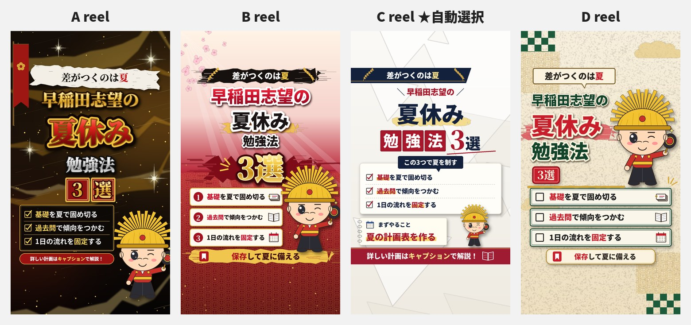
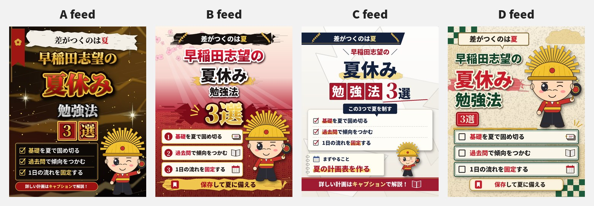
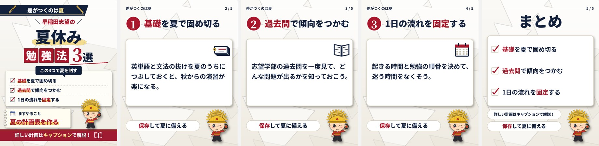

# Hideyoshi Reels 🏯 ちび秀吉の早稲田受験 Instagram 投稿 自動制作

Instagram「@waseda.jyukengoukaku」向けに、**ちびキャラ化した豊臣秀吉が早稲田受験のコツを伝える投稿**を
コマンド1回で制作するシステムです。

| 形式 | 仕様 |
|---|---|
| **リール** | 1080×1920（9:16）の**静止画1枚**を**10秒間そのまま表示**するMP4（H.264 / 30fps / yuv420p・無音トラック付き）。画像の切り替え・スライドショー・ズーム・アニメーションは**しません** |
| **フィード** | 1080×1350（4:5）の画像1枚 |
| **カルーセル** | 1080×1350 の複数枚（表紙 → 各ポイントの詳細 → まとめ） |

```bash
python -m hideyoshi_reels generate                    # リール（既定）
python -m hideyoshi_reels generate --format feed      # フィード
python -m hideyoshi_reels generate --format carousel  # カルーセル
python -m hideyoshi_reels preview                     # 同じテーマで A〜D のデザインを試作して比較
```

APIキーが無くても **モックモード（無料）** で投稿画像・リール動画が完成します。

---

## 目次
1. [自動化の流れ（Trend → Factory → Monetization）](#1-自動化の流れtrend--factory--monetization)
2. [デザインテンプレート A〜D](#2-デザインテンプレート-ad)
3. [まずは無料で1本作ってみる](#3-まずは無料で1本作ってみる)
4. [APIキーを設定して本番品質で作る](#4-apiキーを設定して本番品質で作る)
5. [GitHub Actions で実行する](#5-github-actions-で実行する)
6. [出力されるファイル](#6-出力されるファイル)
7. [安全・品質のしくみ](#7-安全品質のしくみ)
8. [費用の目安](#8-費用の目安)
9. [設定一覧](#9-設定一覧)
10. [フォルダ構成・拡張方法](#10-フォルダ構成拡張方法)
11. [テスト](#11-テスト)
12. [困ったときは](#12-困ったときは)
13. [次のステップ：Instagram 自動投稿の準備](#13-次のステップinstagram-自動投稿の準備)

---

## 1. 自動化の流れ（Trend → Factory → Monetization）

| 段階 | やること | 本番（APIキーあり） | モック（APIキーなし） |
|---|---|---|---|
| **Trend** | 伸びている画像リール・フィード投稿の傾向を分析 → 企画 → 画像に載せる文字原稿（台本）→ 事実確認 | Claude＋Web検索（＋手元の記録 `data/trend_signals.yaml`） | 手元の記録＋ネタ帳 `data/mock_topics.yaml` |
| **Factory** | テーマに合うデザイン（A〜D）を自動選択 → 静止画を生成 → **リールの場合のみ**10秒MP4に変換 | キャラ画像のみ OpenAI（任意） | すべてプログラム描画 |
| **Monetization** | 投稿内容に合った note・アフィリエイトの導線を設計 → キャプション・ハッシュタグ | Claude | ルールベース |
| **出力** | 画像・動画・原稿・キャプション等を保存し、**人間の承認待ち**（`approval.json`）にする | ← | ← |

- **トレンド分析について**: Instagram の他アカウントの数値を自動収集（スクレイピング）することは規約上の問題があるため行いません。公開記事などからのWeb検索と、運営者が `data/trend_signals.yaml` にメモした「伸びた投稿の型」をもとに分析します。将来は自分の投稿のインサイト（保存数など）を自動で取り込めるよう拡張ポイントを用意しています。
- **日本語の文字は画像生成AIに描かせません。** すべてプログラムがフォント（Noto Sans/Serif CJK JP）で正確に配置するので、誤字・文字化けが起きません。
- Instagram への**自動投稿は行いません**（[13章](#13-次のステップinstagram-自動投稿の準備)参照）。

---

## 2. デザインテンプレート A〜D

`design_references/` の4枚の参考画像から、**配色・背景・見出しの強弱・装飾・情報ボックス・イラストの配置**を再現しました（参考画像の文字や数値はコピーしていません）。

| | 名前 | 特徴 | 向いているテーマ |
|---|---|---|---|
| **A** | 黒×金 強フック | 黒地に金の輝き、破れ紙の帯、金→赤→銀の立体見出し、「完全版」風の角バッジ、金枠チェックリスト | NG行動・逆転・保存必須・完全版 |
| **B** | 赤×金 ランキング | 黒い筆帯＋月桂樹、赤と黒の大見出し、金の「〇選」、番号つきボックス＋アイコン、キャラを大きく | 〇選・共通点・ランキング |
| **C** | 白×紺 インフォグラフィック | 紺のリボン、「＼ ／」の小見出し、赤い角文字、吹き出しラベル付きチェックリスト、メモ帳の補足ボックス、赤いCTA帯 | 情報整理・計画・手順・学部比較（フィード向き） |
| **D** | 和紙×緑 行動チェックリスト | 和紙の質感と市松模様、緑×赤の見出し、空のチェックボックス、赤い筆帯の「まずは1つだけでもOK」 | 今日からやること・習慣・行動促進 |

同じ企画を A〜D で試作した例（`python -m hideyoshi_reels preview --mock --topic 夏休み`）:





- **自動選択**: 原稿のキーワード（「NG」「〇選」「計画」「今すぐ」など）、カテゴリ、補足ボックスの有無、投稿形式、AIの推奨をもとに点数をつけ、最も合うデザインを選びます。理由と点数は `design.json` に保存されます。
- **手動変更**: `--design B` や `.env` の `DESIGN_STYLE=B`、GitHub Actions の選択欄で指定できます。
- **比較プレビュー**: `python -m hideyoshi_reels preview` で、同じ企画を A〜D すべてで試作し `compare_reel.png` / `compare_feed.png` に並べます。
- リールは **Instagram の画面UIと重ならない安全領域**（上部ヘッダー・下部キャプション・右側ボタンを避けた範囲）にだけ文字を置きます。
- 1つのテンプレートが、リール（1080×1920）とフィード（1080×1350）の両方に自動で対応します。

---

## 3. まずは無料で1本作ってみる

### 3-1. 必要なもの
- **Python 3.10 以上**（[公式サイト](https://www.python.org/downloads/)）
- **FFmpeg**（リールのMP4化に使用）
  - Mac: `brew install ffmpeg` / Windows: `winget install Gyan.FFmpeg` / Ubuntu: `sudo apt install ffmpeg`
- **日本語フォント（Noto Sans CJK / Noto Serif CJK）** … 見出しの迫力に大きく影響します
  - Ubuntu: `sudo apt install fonts-noto-cjk fonts-noto-cjk-extra`
  - Mac / Windows: [Noto Sans JP](https://fonts.google.com/noto/specimen/Noto+Sans+JP)・[Noto Serif JP](https://fonts.google.com/noto/specimen/Noto+Serif+JP) をダウンロードし、極太（Black）のフォントファイルを `assets/fonts/black.ttf`（ゴシック）、`assets/fonts/serif.ttf`（明朝）、太字を `assets/fonts/bold.ttf` という名前で置く
  - 見つからない場合は別の日本語フォントで代用します（`python -m hideyoshi_reels check` で確認）

### 3-2. 手順
```bash
git clone https://github.com/resettime24-wq/Hideyoshi-reels.git
cd Hideyoshi-reels
python -m venv .venv
source .venv/bin/activate        # Windows は  .venv\Scripts\activate
pip install -r requirements.txt

python -m hideyoshi_reels generate --mock                  # リール（10秒MP4）
python -m hideyoshi_reels generate --mock --format feed    # フィード画像
python -m hideyoshi_reels preview --mock --topic 夏休み     # A〜D比較
```
完成品は `output/日時_形式_デザイン_企画名/` に保存されます。

---

## 4. APIキーを設定して本番品質で作る

| サービス | 用途 | 必須？ | 取得方法 |
|---|---|---|---|
| **Anthropic (Claude)** | トレンド分析・企画・原稿・事実確認・収益化導線・キャプション | 強く推奨 | [console.anthropic.com](https://console.anthropic.com/) でアカウント作成 → Billing でクレジット購入 → API Keys → Create Key |
| **OpenAI** | キャラクター画像（表情）の生成 | 任意 | [platform.openai.com](https://platform.openai.com/) → Billing → [API keys](https://platform.openai.com/api-keys)。画像モデルには組織認証が必要な場合があります。未設定なら仮のオリジナルキャラを使います |

```bash
cp .env.example .env     # Windows は copy .env.example .env
```
`.env` に `ANTHROPIC_API_KEY=sk-ant-...` などを書いて保存し、`python -m hideyoshi_reels generate` を実行します。
`.env` は `.gitignore` 済みなので GitHub には上がりません。

---

## 5. GitHub Actions で実行する

1. **Settings → Secrets and variables → Actions → New repository secret** で `ANTHROPIC_API_KEY`（と任意で `OPENAI_API_KEY`）を登録
2. （note公開後）同じ画面の **Variables** タブで `NOTE_URL` を登録
3. **Actions** タブ → **「Instagram投稿を制作」** → **Run workflow**
   - `format`: reel / feed / carousel
   - `design`: auto / A / B / C / D
   - `preview_all`: A〜Dの比較プレビューも作る
4. 完了後、実行ページ下部の **Artifacts**（`post-番号`）から画像・動画をダウンロード

> **Run workflow ボタンが出ない場合**: GitHub は既定（default）ブランチにあるワークフローにしかボタンを表示しません。このブランチを既定ブランチにマージしてください。

週3回の自動実行は `.github/workflows/generate-post.yml` の `schedule` の3行の `#` を外すだけです。

---

## 6. 出力されるファイル

| ファイル | 内容 |
|---|---|
| `post_image.png` | 投稿画像（リール: 1080×1920 / フィード: 1080×1350） |
| `reel.mp4` | **リールのみ**。上の画像1枚を10秒表示する動画 |
| `carousel/slide_01.png …` | **カルーセルのみ**。表紙・詳細・まとめ |
| `post.txt` | そのまま貼れるキャプション＋ハッシュタグ |
| `caption.txt` / `hashtags.txt` / `hashtags_extended.txt` | キャプション本文 / 投稿用タグ / 予備のタグ |
| `trend_report.json` | トレンド分析の結果（傾向・伸びる型・狙い目テーマ・出典） |
| `plan.json` / `post_content.json` | 企画 / 画像に載せた文字原稿（台本） |
| `design.json` | 選んだデザインと理由・各デザインの点数 |
| `layout_check.json` | 安全領域のはみ出し・文字の重なり・文字欠けの自動検査結果 |
| `factcheck.json` / `review_checklist.md` | 事実確認の結果 / 投稿前チェックリスト |
| `monetization.json` | 収益化導線（note企画案・アフィリエイト候補・表示義務などの注意） |
| `approval.json` | 人間の承認ステータス（`pending` → 確認後 `approved`） |
| `production_log.json` / `run.log` | 制作履歴（所要時間・使ったAPI・概算費用・警告）/ 詳細ログ |

---

## 7. 安全・品質のしくみ

- **事実確認**: 入試制度・偏差値・倍率・合格率などは断定しないようAIに指示し、Web検索で確認できなかった記述は自動で断定しない表現に置き換えます。数字を含む文は必ず `review_checklist.md` に載ります。人が確認した事実は `data/verified_facts.yaml` に登録できます。
- **レイアウト検査**: 全テキストの位置を記録し、安全領域外・文字同士の重なり・フォントに無い文字を自動検出します（テストでは全ネタ × 全デザイン × 全形式で検査）。
- **誤認防止**: 大学ロゴや校舎写真は使わず、公式アカウントと誤認される表現を避けます。
- **収益化のルール**: `NOTE_URL` が未設定の間はリンク誘導をしません。アフィリエイトは商品の「種類」の提案のみで、実在のURLや価格は生成しません。`AFFILIATE_ENABLED=true` のときはキャプション冒頭に【PR】表記を入れます（ステルスマーケティング規制への配慮）。
- **人間の承認**: 投稿前に必ず人が確認する前提で、`approval.json` が `approved` でないと投稿処理を拒否する仕組みを用意しています。

---

## 8. 費用の目安

1投稿あたり（1ドル=150円換算の目安）

| 項目 | 目安 |
|---|---|
| Claude（トレンド分析・企画・原稿・事実確認・収益化・キャプション、Web検索込み） | 約 30〜60円 |
| OpenAI キャラ画像（表情ごとに**初回のみ**、1枚約10円） | 0〜約50円 |
| 投稿画像・MP4 の生成 / GitHub Actions | 0円 |
| **合計** | **約 30〜60円／投稿**（週3本で月 約400〜800円） |

実際の概算は毎回 `production_log.json` の `estimated_cost_jpy` に記録されます。

---

## 9. 設定一覧

| 変数 | 既定値 | 説明 |
|---|---|---|
| `POST_FORMAT` | reel | reel / feed / carousel |
| `DESIGN_STYLE` | auto | auto / A / B / C / D |
| `REEL_SECONDS` | 10 | リールの再生時間（秒） |
| `CAROUSEL_MAX_SLIDES` | 6 | カルーセルの最大枚数 |
| `HR_MODE` / `HR_STRICT` | auto / false | mock で全工程無料 / true でAPIエラー時に停止 |
| `CLAUDE_MODEL` / `CLAUDE_EFFORT` | claude-opus-5-5 / medium | 使用モデルと思考の深さ |
| `TREND_WEB_SEARCH` / `FACTCHECK_WEB_SEARCH` | true / true | Web検索によるトレンド分析・事実確認 |
| `NOTE_URL` / `AFFILIATE_ENABLED` | 空 / false | 収益化導線 |
| `HASHTAG_LIMIT` | 5 | 投稿用ハッシュタグ数 |

AIへの指示（企画・原稿のルール）は `hideyoshi_reels/trend/prompts.py` で変更できます。

---

## 10. フォルダ構成・拡張方法

```
hideyoshi_reels/
  __main__.py          コマンド（generate / preview / check / history）
  pipeline.py          Trend → Factory → Monetization をつなぐ本体
  config.py / models.py / history.py / utils.py
  llm/claude.py        Claude API
  trend/               analyzer.py（トレンド分析）planner.py（企画）writer.py（原稿）factcheck.py / prompts.py
  factory/             fonts.py canvas.py（日本語の正確な配置）decor.py（装飾パーツ）
                       templates/（A〜D・自動選択）render.py（画像生成）video.py（静止画→10秒MP4）layout_check.py
  monetization/        planner.py（note・アフィリエイト導線）caption.py
  images/              キャラクター管理（character.py）・画像API（providers.py）・仮キャラ（mock_art.py）
  publishers/          将来の自動投稿・インサイト分析のひな形（承認チェック付き）
assets/character/      キャラ設定・参照画像・表情素材
design_references/     デザイン参考画像 A〜D（見た目の参考のみ）
data/                  履歴・トレンド記録・モック用ネタ帳・確認済み事実
tests/                 自動テスト
```

- **新しいデザイン（E）を追加**: `factory/templates/` に `Template` を継承したクラスを作り、`templates/__init__.py` の `TEMPLATES` と `RULES` に登録
- **トレンドの記録**: `data/trend_signals.yaml` に伸びた投稿の「型」をメモすると企画に反映されます

---

## 11. テスト

```bash
python -m pytest
```
APIキー不要・無料。次の内容を確認します（39件）。
- 全ネタ（8本）× A〜D × リール/フィードで、はみ出し・重なり・文字欠けが無いこと、カルーセル全ページの検査
- リールMP4が 1080×1920 / H.264 / yuv420p / 30fps / 300フレーム / 10秒で、最初と最後のフレームが同じ絵（動きが無い）こと
- デザインの自動選択・手動指定、トレンド分析・企画・原稿の文字数制限・事実確認・収益化・キャプション
- **本番API用のコード**（Claude・OpenAI）が、偽のAPIサーバー相手に最後まで正しく動くこと
- 承認前は投稿処理が拒否されること

---

## 12. 困ったときは

| 症状 | 対処 |
|---|---|
| 見出しが細い・迫力がない | Noto Sans/Serif CJK の Black を入れる（3-1参照）。`check` で `（代替）` と出ていないか確認 |
| `ffmpeg が見つかりません` | FFmpeg をインストールしてターミナルを開き直す（フィード・カルーセルは不要） |
| `AuthenticationError` / 401 | APIキーの貼り間違い（前後の空白・改行に注意） |
| 本番のはずがモックになった | `production_log.json` の `fallbacks` に理由が記録されます |
| `layout_check.json` に警告が出た | 原稿が長すぎる可能性。画像を目視確認し、必要なら `--design` を変えて再生成 |

---

## 13. 次のステップ：Instagram 自動投稿の準備

1. Instagram をプロアカウント（クリエイター or ビジネス）に切り替え
2. [Meta for Developers](https://developers.facebook.com/) でアプリを作成し、Instagram API（コンテンツ公開）を追加
3. 投稿権限つきの長期アクセストークンを取得し、`IG_ACCESS_TOKEN` / `IG_USER_ID` を GitHub Secrets に登録
4. 画像・動画を**公開URL**で置く場所（Cloudflare R2、AWS S3 など）を用意（APIはファイルではなくURLを受け取るため）
5. `publishers/instagram.py` の `publish()` を実装（リール・フィード・カルーセルそれぞれの手順はファイル内に記載）。`approval.json` が `approved` の投稿だけを投稿する仕組みはすでに入っています
6. インサイト（保存数・リーチ）を `InsightsClient` で取得し、`data/trend_signals.yaml` に自動で追記すれば、Trend の分析精度が上がります

---

## 素材・著作権について
- キャラクター: 史実の人物をモチーフにした**オリジナルデザイン**。仮キャラ・背景・装飾・アイコンはすべてプログラムで描いた自作素材
- フォント: Noto Sans CJK / Noto Serif CJK（SIL Open Font License）
- `design_references/` の画像はデザインの参考用です。文字・数値・実績を流用しないでください
